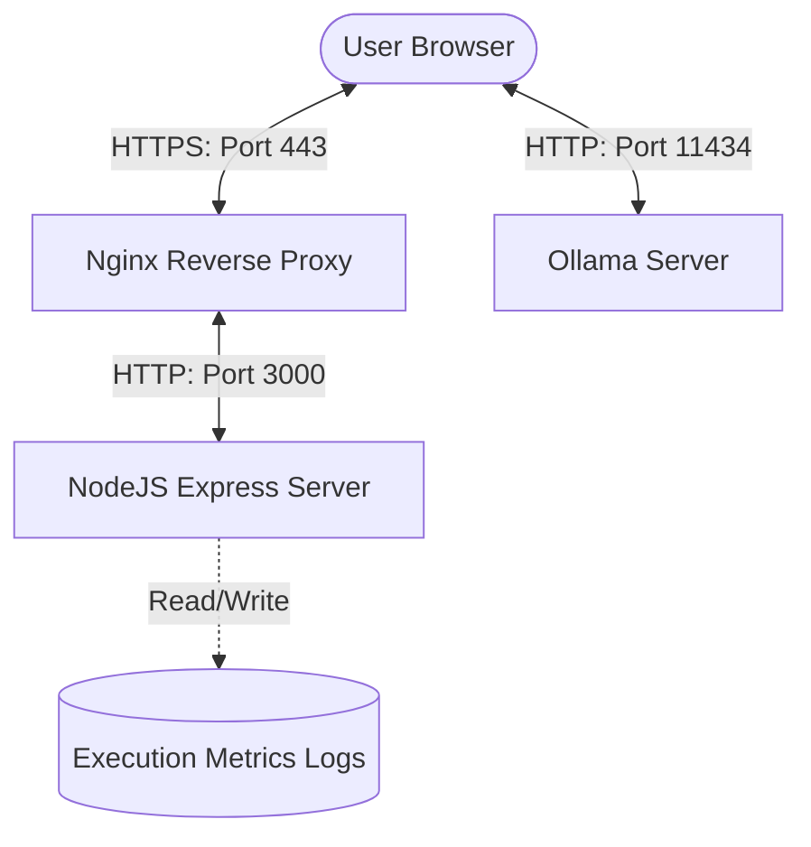

# AIMatch Deployment Guide

This document provides a comprehensive guide for deploying **AIMatch** to both testing/staging and production environments. It covers containerized setups (Docker), standalone virtual machines, system services configuration, reverse proxy setup, and GPU acceleration for the local Ollama AI model.

---

## 🏗 System Architecture

AIMatch consists of three primary components:
1. **Frontend Client (Vite + React)**: Compiled to optimized static assets (`index.html`, `js`, `css`) served by the Express server.
2. **Backend Server (Express + Node.js)**: Serves static assets, runs the `/api` endpoints, logs performance metrics, and supports programmatic CSV/JSON reconciliation.
3. **AI Inference Service (Ollama + `llama3.1:8b`)**: Executed on-premise or on a dedicated VM. The frontend client calls the Ollama instance directly via CORS to execute semantic narration matches.



---

## ⚙️ Environment Configuration

Create a `.env` file in the root of the project to configure the environment variables:

| Variable | Default | Description |
|:---|:---|:---|
| `PORT` | `3000` | The port the Node.js Express server runs on. |
| `OLLAMA_HOST` | `http://localhost:11434` | The URL of the Ollama server accessible by client browsers. |
| `OLLAMA_MODEL` | `llama3.1:8b` | The local LLM model name used for semantic matching. |
| `NODE_ENV` | `production` | Set to `production` to optimize performance and serve pre-built static assets. |

---

## 🐳 Option 1: Containerized Deployment (Recommended)

Docker Compose is the recommended way to deploy AIMatch. It guarantees that the Node.js environment, dependencies, and Ollama configuration are isolated and identical between environments.

### 1. Project Dockerfile
Create a `Dockerfile` in the root of the project:

```dockerfile
# Build Stage
FROM node:20-alpine AS builder
WORKDIR /app
COPY package*.json ./
RUN npm install
COPY . .
RUN npm run build

# Production Stage
FROM node:20-alpine
WORKDIR /app
COPY package*.json ./
RUN npm install --omit=dev
COPY --from=builder /app/dist ./dist
COPY --from=builder /app/server.ts ./server.ts
COPY --from=builder /app/src/reconciler.ts ./src/reconciler.ts
COPY --from=builder /app/src/types.ts ./src/types.ts

# Install tsx globally to run typescript server file
RUN npm install -g tsx
ENV NODE_ENV=production
EXPOSE 3000
CMD ["tsx", "server.ts"]
```

### 2. Multi-Container Compose Configuration
Create a `docker-compose.yml` file in the root directory:

```yaml
version: '3.8'

services:
  app:
    build:
      context: .
      dockerfile: Dockerfile
    ports:
      - "3000:3000"
    environment:
      - PORT=3000
      - NODE_ENV=production
      - OLLAMA_HOST=http://localhost:11434
      - OLLAMA_MODEL=llama3.1:8b
    restart: unless-stopped
    volumes:
      - ./logs:/app/logs
    depends_on:
      - ollama

  ollama:
    image: ollama/ollama:latest
    ports:
      - "11434:11434"
    volumes:
      - ollama_data:/root/.ollama
    restart: unless-stopped
    # Enable GPU acceleration if running on a host with CUDA support
    deploy:
      resources:
        reservations:
          devices:
            - driver: nvidia
              count: all
              capabilities: [gpu]

volumes:
  ollama_data:
```

### 3. Deploying via Compose
1. Ensure Docker and the NVIDIA Container Toolkit (for GPU support) are installed on the host.
2. Spin up the containers:
   ```bash
   docker compose up -d --build
   ```
3. Pull the `llama3.1:8b` model inside the Ollama container:
   ```bash
   docker compose exec ollama ollama run llama3.1:8b
   ```

---

## 🖥 Option 2: Standalone VM Deployment (Systemd & PM2)

If you are deploying directly to a Virtual Private Server (VPS) running Linux (e.g. Ubuntu 22.04), use PM2 for process monitoring and systemd for Ollama.

### Step 1: Install System Dependencies
```bash
# Update system packages
sudo apt update && sudo apt upgrade -y

# Install Node.js (v20.x)
curl -fsSL https://deb.nodesource.com/setup_20.x | sudo -E bash -
sudo apt-get install -y nodejs

# Install build essentials and pm2
sudo npm install -g pm2 tsx
```

### Step 2: Set Up Ollama
Install Ollama using the official installer script:
```bash
curl -fsSL https://ollama.com/install.sh | sh
```
Verify that Ollama is running as a system service:
```bash
sudo systemctl status ollama
```
Download the required model:
```bash
ollama pull llama3.1:8b
```

### Step 3: Configure Ollama CORS
By default, Ollama binds to `127.0.0.1:11434` and blocks external browser requests. If browser clients are accessing the app, Ollama must listen on all interfaces and allow requests from your app's domain.

1. Edit the systemd service file:
   ```bash
   sudo systemctl edit ollama.service
   ```
2. Insert the following environment variables under the `[Service]` block:
   ```ini
   [Service]
   Environment="OLLAMA_HOST=0.0.0.0"
   Environment="OLLAMA_ORIGINS=*"
   ```
3. Save and reload systemd configuration:
   ```bash
   sudo systemctl daemon-reload
   sudo systemctl restart ollama
   ```

### Step 4: Clone and Build AIMatch
```bash
cd /var/www
sudo git clone <your-repository-url> aimatch
cd aimatch

# Copy and update env
sudo cp .env.example .env
# Edit OLLAMA_HOST inside .env to point to public domain or local address

# Install and build
sudo npm install
sudo npm run build
```

### Step 5: Start the Application with PM2
Launch the Express server with PM2 to keep it running in the background and survive system reboots:
```bash
pm2 start tsx --name "aimatch" -- server.ts
pm2 save
pm2 startup
```

---

## 🔒 Step 6: Reverse Proxy Setup (Nginx + SSL)

To serve the app securely over HTTPS (which is a requirement for modern browser integrations), configure Nginx as a reverse proxy.

1. Install Nginx:
   ```bash
   sudo apt install nginx -y
   ```
2. Create an Nginx site configuration `/etc/nginx/sites-available/aimatch`:
   ```nginx
   server {
       listen 80;
       server_name aimatch.yourdomain.com;

       location / {
           proxy_pass http://localhost:3000;
           proxy_http_version 1.1;
           proxy_set_header Upgrade $http_upgrade;
           proxy_set_header Connection 'upgrade';
           proxy_set_header Host $host;
           proxy_cache_bypass $http_upgrade;
           client_max_body_size 500M;
       }
   }
   ```
3. Enable the site and restart Nginx:
   ```bash
   sudo ln -s /etc/nginx/sites-available/aimatch /etc/nginx/sites-enabled/
   sudo nginx -t
   sudo systemctl restart nginx
   ```
4. Obtain an SSL certificate via Let's Encrypt:
   ```bash
   sudo apt install certbot python3-certbot-nginx -y
   sudo certbot --nginx -d aimatch.yourdomain.com
   ```

---

## 🧪 Testing Environment vs. 🚀 Production Environment

| Feature | Testing / Staging | Production |
|:---|:---|:---|
| **Ollama Hardware** | CPU-Only (slow but functional) | dedicated VM with GPU (e.g., NVIDIA T4, A10G) |
| **SSL Requirements** | Self-signed or HTTP | Strict SSL/TLS (Certbot / AWS ACM) |
| **Payload Limits** | Small test datasets | Set proxy timeouts to 10m for large files |
| **Authentication** | Optional basic auth | API key validation in reverse proxy / middleware |
| **Log Rotation** | Default JSON writing | Log forwarding to CloudWatch, ELK, or Datadog |

### Staging Checklist
1. Ensure the fallback to **Fuzzball** works when Ollama is offline.
2. Confirm `.xlsx` parsing handles date parsing options correctly (e.g., Excel Serial Numbers vs. String Dates).
3. Verify that `/api/v1/metrics` logging successfully writes to the `logs/execution_metrics.json` file.

### Production Checklist
1. Verify that **Ollama CORS (`OLLAMA_ORIGINS`)** restricts requests to the app's production domain only.
2. Verify reverse proxy timeout configurations:
   ```nginx
   proxy_read_timeout 600s;
   proxy_connect_timeout 600s;
   proxy_send_timeout 600s;
   ```
3. Establish a standard log backup system for the `logs/` folder to prevent disk-space exhaustion from large execution metric history trails.

---

### ✍️ Credits
* **Technology Stack:** Powered by [Ollama](https://ollama.com) + `llama3.1:8b`
